# AI-Powered Bug Analysis Dashboard

> **A conceptual and architectural overview of an automated, evidence-driven first-level root-cause analysis system for test-automation failures.**

---

## Important Disclaimer

Due to Non-Disclosure Agreements (NDA), the source code and the specific execution logic of this project are **not publicly available**. The tool was developed as a proprietary internal engineering solution for a large-scale network-equipment test-automation environment. This documentation is a **conceptual and architectural overview** of the work. It deliberately omits product names, internal hostnames, team structures, prompts, rules files, and implementation details.

The goal is to share the *idea*, the *design principles*, and the *lessons learned*, so that others facing a similar problem can build their own solution.

---

## Table of Contents

- [AI-Powered Bug Analysis Dashboard](#ai-powered-bug-analysis-dashboard)

  - [Important Disclaimer](#important-disclaimer)

  - [Table of Contents](#table-of-contents)

  - [1. Problem Statement](#1-problem-statement)

    - [Why first-level analysis is hard](#why-first-level-analysis-is-hard)

    - [The consequence](#the-consequence)

  - [2. Proposed Solution](#2-proposed-solution)

  - [3. Design Principles](#3-design-principles)

  - [4. System Architecture](#4-system-architecture)

    - [4.1 High-level view](#41-high-level-view)

    - [4.2 Logical components](#42-logical-components)

  - [5. The Pipeline in Detail](#5-the-pipeline-in-detail)

    - [Stage 1 – Fetch](#stage-1--fetch)

    - [Stage 2 – Analyse](#stage-2--analyse)

    - [Stage 3 – Build](#stage-3--build)

    - [Stage 4 – Publish](#stage-4--publish)

  - [6. How a Bug Is Analysed](#6-how-a-bug-is-analysed)

    - [6.1 The seven-step procedure](#61-the-seven-step-procedure)

      - [Step 1 – Read the report](#step-1--read-the-report)

      - [Step 2 – Find the newest run](#step-2--find-the-newest-run)

      - [Step 3 – Download root files](#step-3--download-root-files)

      - [Step 4 – Find the first failure](#step-4--find-the-first-failure)

      - [Step 5 – Research](#step-5--research)

      - [Step 6 – Decide](#step-6--decide)

      - [Step 7 – Deliver](#step-7--deliver)

    - [6.2 Anatomy of an analysis](#62-anatomy-of-an-analysis)

    - [6.3 The evidence ledger](#63-the-evidence-ledger)

    - [6.4 Behavioural guard-rails in the rules](#64-behavioural-guard-rails-in-the-rules)

  - [7. Domain Knowledge Base](#7-domain-knowledge-base)

    - [7.1 What it is](#71-what-it-is)

    - [7.2 Structure](#72-structure)

    - [7.3 How it is used](#73-how-it-is-used)

    - [7.4 Why a document and not a vector store?](#74-why-a-document-and-not-a-vector-store)

  - [8. Repository Access for the Agent](#8-repository-access-for-the-agent)

  - [9. Verdicts, Evidence and Confidence](#9-verdicts-evidence-and-confidence)

    - [9.1 Routing verdict](#91-routing-verdict)

    - [9.2 Confidence](#92-confidence)

  - [10. Duplicate Detection (Similarity Triage)](#10-duplicate-detection-similarity-triage)

  - [11. Dashboard Experience](#11-dashboard-experience)

    - [11.1 Layout](#111-layout)

    - [11.2 Features](#112-features)

  - [12. Reliability, Idempotency and Failure Handling](#12-reliability-idempotency-and-failure-handling)

  - [13. Security and Operational Considerations](#13-security-and-operational-considerations)

  - [14. Technology Overview](#14-technology-overview)

  - [15. Limitations and Non-Goals](#15-limitations-and-non-goals)

  - [16. Takeaways](#16-takeaways)

---

## 1. Problem Statement

In large automation programmes, thousands of test cases run nightly against real hardware in shared labs. When a test fails, a bug ticket is raised in an issue tracker (for example, Jira). Engineers then have to work out *why* it failed. In practice this first-level analysis is slow, repetitive, and inconsistent.

### Why first-level analysis is hard

| Challenge | What it looks like in practice |

| --- | --- |

| **The visible error is rarely the real error** | A ticket usually quotes the *last* failure. The real cause is the *first* failure, buried deep in a large execution log. Later failures are symptoms. |

| **Evidence is scattered** | The facts live in ticket comments, links to execution logs, test-suite source code, library code, and in the heads of senior engineers. |

| **Logs are huge** | Structured result files are often anywhere from a few MB up to 50 MB. Nobody can read them end to end, so people grep and guess. |

| **Ownership is ambiguous** | Was it a broken test, a product defect, or a lab/environment issue? A wrong guess sends the ticket to the wrong team and wastes days. |

| **Duplicates are common** | The same underlying defect resurfaces under many ticket keys, so effort is repeated. |

| **Knowledge is tribal** | Understanding what a test *should* do requires deep domain knowledge that new engineers lack. |

| **Inconsistent quality** | Two engineers analysing the same ticket produce different depth, format, and conclusions. |

### The consequence

- Slow turnaround from "test failed" to "someone knows why".

- Misrouted tickets and ping-pong between teams.

- Duplicate investigations.

- Senior engineers spending their time on repetitive triage instead of fixing problems.

---

## 2. Proposed Solution

An **unattended, scheduled pipeline** that:

1. **Pulls** the team's open failure tickets from the issue tracker.

2. **Analyses** every ticket that has not yet been analysed, using an autonomous AI coding agent that is given three things:

   - the ticket content,

   - a **domain knowledge base** describing what the tests are supposed to do,

   - **read access to the test-automation repository** so it can inspect the real source code.

3. **Produces** an evidence-backed first-level root-cause analysis with a routing verdict and a list of similar earlier tickets.

4. **Publishes** everything as a fast, searchable, static web dashboard.

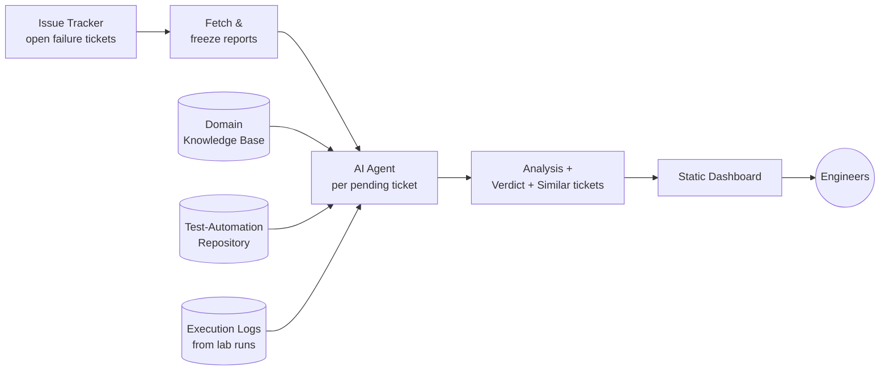

The outcome: when an engineer opens a ticket, a plain-language explanation of **what failed first, why, who most likely owns it, and what to do next** is already waiting, together with the evidence supporting it.

---

## 3. Design Principles

These principles shaped every architectural choice.

1. **Evidence over opinion.** Every claim must be traceable to an observed fact (a log line, a source line, a knowledge-base entry). Unsupported statements are labelled as inferences or unknowns.

2. **First failure, not last failure.** The analysis walks back to the earliest failure that explains the rest.

3. **Search, don't read.** Large artefacts (logs, knowledge base, repositories) are searched and sampled in small windows, never loaded whole.

4. **Write-once, idempotent.** Original reports and finished analyses are never overwritten. Re-running the pipeline is always safe.

5. **Batch, not server.** A scheduled job produces static files. There is no always-on backend to secure or scale.

6. **Separation of concerns.** The pipeline code orchestrates; the *analysis behaviour* lives in a human-readable rules document that domain experts can edit without touching code.

7. **Honest uncertainty.** The system may answer "inconclusive". A confident wrong answer is worse than an honest "I don't know".

8. **Atomic publishing.** Readers never see a half-built dashboard.

---

## 4. System Architecture

### 4.1 High-level view

The system is a **scheduled batch job**. Nothing stays running between executions. A scheduler starts a launcher, the launcher refreshes the test repository, and the orchestrator runs four sequential stages and then exits. Browsers later load only static files. They never talk to the issue tracker or to the AI agent.

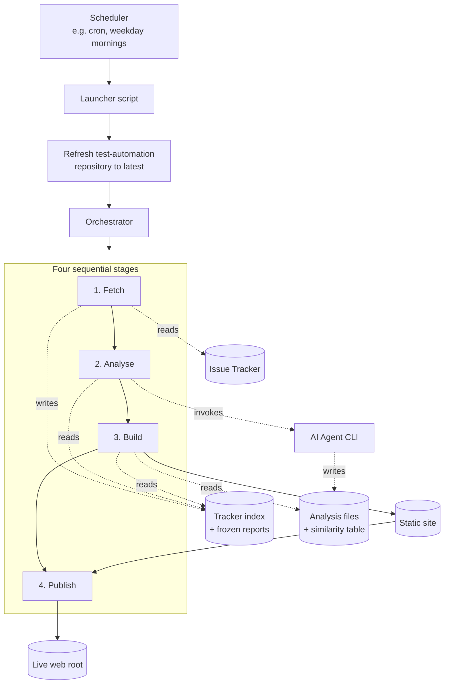

### 4.2 Logical components

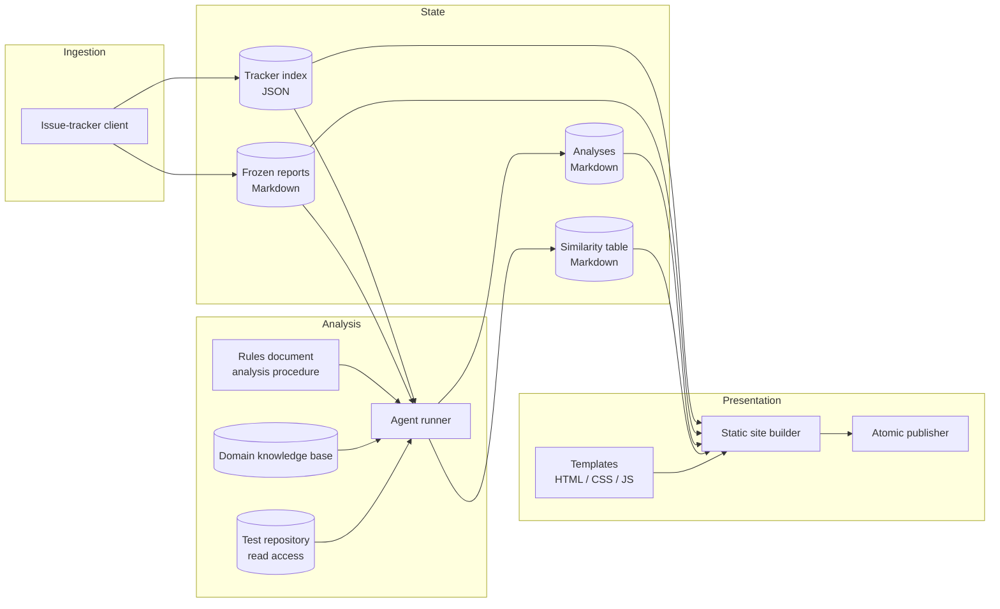

| Component | Responsibility |

| --- | --- |

| **Launcher** | Entry point for the scheduler. Refreshes the test repository, prepares the runtime environment, runs the orchestrator, and captures the log. |

| **Orchestrator** | Runs fetch → analyse → build → publish and returns a success or failure exit code. |

| **Issue-tracker client** | Runs a configurable query, saves each ticket as a Markdown report (only if not already saved), and records team and priority. |

| **Tracker index** | A simple JSON list. It is the single source of truth for "what work exists" and "what is already analysed". |

| **Agent runner** | Starts one headless AI agent per un-analysed ticket and verifies it produced a non-empty result. |

| **Rules document** | The analysis procedure, written in Markdown. It is the *program* the agent follows. |

| **Domain knowledge base** | A generated, searchable description of the test suite: purposes, keywords, dependencies, expected behaviour. |

| **Static site builder** | Converts Markdown to HTML, renders the board, KPIs and tiles, and cleans up stale pages. |

| **Atomic publisher** | Swaps the new site into place only after it is completely built. |

---

## 5. The Pipeline in Detail

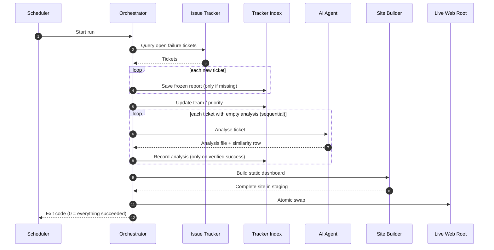

### Stage 1 – Fetch

- A configurable query selects the relevant open tickets.

- Each ticket is written once as a Markdown **report** containing summary, status, priority, description, environment, and every comment.

- The report is **frozen**: later runs will not rewrite it. Team and priority in the tracker index are still refreshed.

- Transient tracker errors are retried with back-off. If the fetch fails completely, the live dashboard is left untouched.

### Stage 2 – Analyse

- The tracker index is the work list. A ticket is "pending" when its analysis field is empty.

- One AI-agent process runs per pending ticket, sequentially.

- Success requires **all** of the following: a clean exit, a changed analysis file, and non-empty content. Anything else leaves the ticket pending so the next run retries it.

- Temporary working files are always cleaned up, even after a crash.

- If nothing is pending, the agent and its credentials are never touched.

### Stage 3 – Build

- The board (KPIs, team sections, tiles) is **rendered at build time** into static HTML.

- Each ticket gets its own page containing the report and the analysis.

- The similarity table is rendered as its own page.

### Stage 4 – Publish

- The finished site is copied beside the live directory, then swapped in with renames.

- If the copy fails, the live site is unchanged. If the swap fails midway, the previous version is restored.

---

## 6. How a Bug Is Analysed

The orchestration code does **not** implement root-cause analysis. It launches an autonomous coding agent with a short prompt, and the agent follows a **rules document**: a structured, human-readable procedure written by domain experts. Changing how analyses are performed means editing that document, not the code.

### 6.1 The seven-step procedure

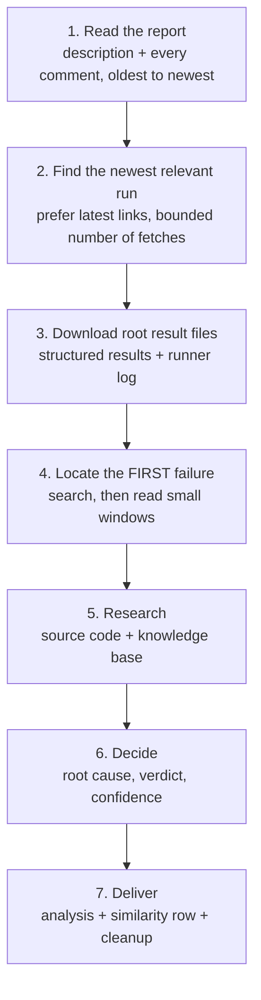

#### Step 1 – Read the report

The agent reads the description and **every** comment in chronological order. Earlier diagnoses become *hypotheses*, links become *pointers*, "fix integrated" notes become *fix points*, and automated bot noise is ignored. Every URL is classified (execution log, job report, image, tracker or wiki link, other). The newest comments are treated as the current state of discussion, and the final write-up must agree or disagree with them explicitly.

#### Step 2 – Find the newest run

Links are ordered newest-first. The agent analyses the first reachable execution folder. A strict cap on the number of fetches prevents runaway behaviour, and rate-limit responses are handled with a short wait and one retry. Logs that have been moved by storage clean-up are detected and rewritten to their new location. If a run turns out to have zero failures, the agent falls back to the next candidate link.

#### Step 3 – Download root files

The structured result file is the master record. The runner's own log is downloaded as well. The rendered log page is used for confirmation and linking, not for parsing. Extra diagnostic folders are fetched only when the ticket points at them.

#### Step 4 – Find the first failure

Result files can reach up to 50 MB, so the agent **searches** first and then reads a small window around each hit. Key subtleties:

- It anchors on a *failing status that carries a message*, not simply the first line marked "FAIL". Many failures are intentionally *caught* by retry or error-tolerant keywords and are not real failures.

- It records the suite, test, **phase** (suite setup, test setup, body, teardown), nested keyword chain, error text and timestamp.

- The **first failure** is the earliest failure that actually caused a test or suite to fail. Repeats afterwards are symptoms.

- The runner's own log is used to understand imports, variable files, and listeners around the failure time.

#### Step 5 – Research

Two sources are combined:

- **Source code** — the failing suite's path is mapped into the test repository. The agent opens the suite, follows the keyword chain into resource files, helper libraries and variable files, and cites a file and line only after actually reading it.

- **Domain knowledge base** — describes what *should* happen. Logs say what *did* happen. The comparison between the two is the heart of the analysis.

#### Step 6 – Decide

The agent walks backwards from the first failure until it reaches an event that nothing earlier explains and that is supported by observation rather than inference. That event is the **root cause**, stated in one plain sentence. See [Verdicts, Evidence and Confidence](#9-verdicts-evidence-and-confidence).

#### Step 7 – Deliver

The agent writes the analysis, appends one row to the similarity table, and deletes its working folder.

### 6.2 Anatomy of an analysis

Each analysis is written for a reader who has **not seen the bug before**.

| Section | Audience | Content |

| --- | --- | --- |

| **Top half** | Everyone | Plain-language summary: what failed, why, verdict, confidence, and the proposed next action (only when conclusive). |

| **Expected vs observed** | Test owners | A comparison of knowledge-base expectation and what the logs showed. |

| **Appendix** | Reviewers | Evidence ledger, timeline of events, reasoning chain, and the list of sources checked. |

### 6.3 The evidence ledger

Every fact in the analysis is tagged:

| Tag | Meaning |

| --- | --- |

| **OBSERVED** | Directly quoted from a log, source file, or knowledge-base entry. |

| **INFERRED** | A deduction, citing the OBSERVED entries it depends on. |

| **UNKNOWN** | Something that could not be established. |

The ledger is append-only. This makes every conclusion auditable, so a reviewer can check the reasoning rather than trust it.

### 6.4 Behavioural guard-rails in the rules

- Operate fully headless: no questions, no interactive tools.

- Prefer simple command-line tools (HTTP download, unzip, text search, small file windows).

- Never read a large log end-to-end.

- Never modify the original report.

- Keep temporary files only in a dedicated working folder.

- Never propose a fix unless the conclusion is conclusive.

---

## 7. Domain Knowledge Base

Raw logs can say *what* happened, but not *what should have* happened. A domain knowledge base bridges that gap.

### 7.1 What it is

A single, **generated** Markdown document that describes a target slice of the test-automation repository. It is produced by analysing the repository's suites, resource files and libraries, optionally enriched with expert notes. It is intentionally large, on the order of tens of thousands of lines, because it is designed to be **searched, not read**.

### 7.2 Structure

| Section | Contents | Used for |

| --- | --- | --- |

| **Overview** | Purpose of the test area, folder tree, statistics (suites, test cases, keywords, files). | Orientation and scope checks |

| **Technology stack** | Frameworks, libraries, protocols, environment variables. | Understanding the tooling |

| **Folder structure** | A table of files with type, purpose, tags, and setup. | Locating things |

| **Dependency graph** | Forward imports, reverse imports, external libraries, repository-level APIs. | Tracing "who uses what" |

| **File reference** | Per file: purpose, dependencies, size, **code notes**, imports, variables, keywords, test-case step tables. | Understanding a failing file |

| **Keyword index** | Each keyword with where it is defined, its arguments, and where it is used. | "What should this keyword do?" |

| **Test-case inventory** | Per test case: suite, tags, preconditions, expected outcome. | "What is this test for?" |

| **Execution context** | How CI selects cases, required environment, execution order, constraints. | Environment-related failures |

| **Known gaps** | Ambiguities and suspicious logic discovered while building the knowledge base. | Flagging known unclear areas |

### 7.3 How it is used

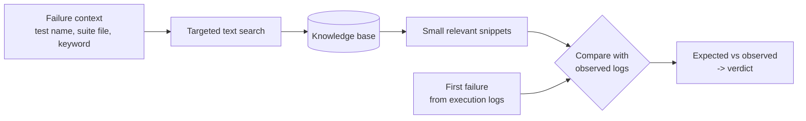

- **Retrieval is deliberately simple.** There is no vector database or embedding service. Structured headings and tables allow exact, explainable lookups by test name, suite file, or keyword.

- **A mapping from need to section** tells the agent where to look:

| Need | Where to look |

| --- | --- |

| What is this case for? | Test-case inventory, then file reference |

| What should this keyword do? | Keyword index |

| Which libraries are involved? | Dependency graph |

| How is the environment brought up? | Execution context |

| Is this area known to be unclear? | Known gaps |

- **Scope awareness.** The agent checks whether the failing case belongs to the knowledge base's target area. If not, it says so and relies on the repository alone.

- **Knowledge is regenerated** when the repository evolves, and can be enriched by human expert notes that survive regeneration.

### 7.4 Why a document and not a vector store?

| Consideration | Structured document + text search |

| --- | --- |

| **Explainability** | Every retrieved fact has an exact location that can be cited. |

| **Determinism** | Same query, same result. |

| **Simplicity** | No extra infrastructure, easy to version and review. |

| **Fit** | Test names, keywords, and file paths are exact identifiers. Exact search suits them better than semantic similarity. |

---

## 8. Repository Access for the Agent

A key idea of the design is that the agent is not limited to what is written in the ticket. It is **given access to the real test-automation source code**.

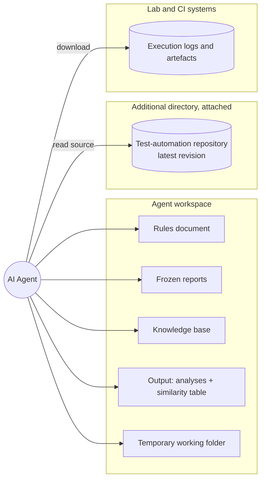

- **Fresh code.** Before every run, the launcher updates the repository to the latest revision. The agent therefore analyses the code that actually ran, not a stale copy.

- **Attached as an extra directory.** The repository sits outside the agent's workspace and is attached explicitly. If it is unavailable, the pipeline degrades gracefully and still analyses from the report, the logs, and the knowledge base.

- **Path mapping.** Source paths recorded in the execution results are mapped into the repository, so the agent can open the exact suite that failed and follow the chain of keywords, resources, libraries, and variable files.

- **Cite only what was read.** File and line references are included only after the file was opened.

- **Network access to logs.** The agent downloads result files from lab and CI systems over HTTP, within a bounded number of requests.

- **Scoped writes by instruction.** The rules direct the agent to write only the analysis file, one similarity row, and its temporary folder.

> Operational note: the agent is expected to be run under a dedicated low-privilege account on an internal network. See [Security and Operational Considerations](#13-security-and-operational-considerations).

---

## 9. Verdicts, Evidence and Confidence

### 9.1 Routing verdict

The main value of first-level analysis is **routing**: getting the ticket to the right owner.

| Verdict | Typical pattern | Routed to |

| --- | --- | --- |

| **Test defect** | The first failure is in setup, imports, variables, or an assertion **before the device or product is exercised**; or the test contradicts the documented spec while the product matches it. | Test-automation team |

| **Product defect** | The first failure is the product's response **after** a product action; the device state differs from the documented expectation. | Product development team |

| **Test environment** | Connectivity, file-transfer, artefact or lab issues; neither test nor product is at fault. | Lab / infrastructure team |

| **Inconclusive** | No readable results, unknown failing keyword, or no observed failure message. | Human investigation |

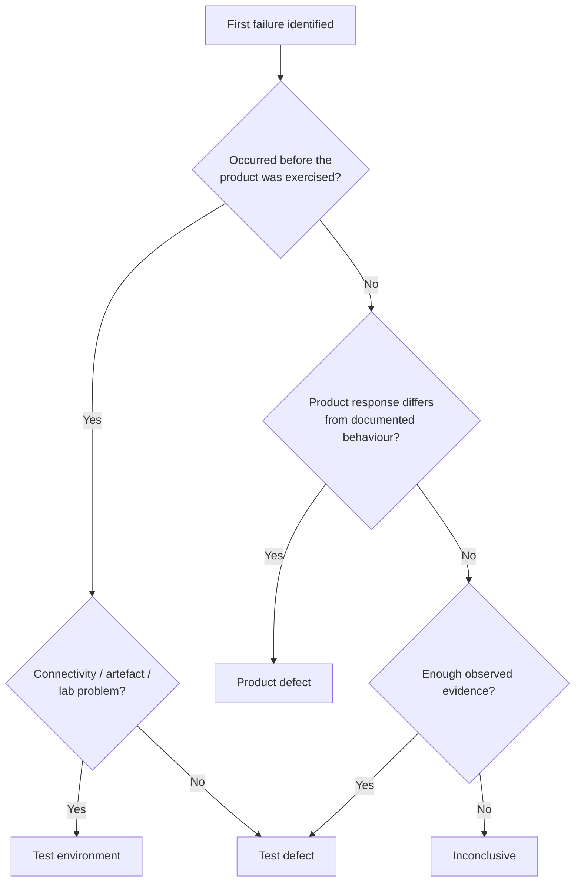

*(The diagram is a simplification. The real procedure weighs the evidence ledger, not only a single question.)*

### 9.2 Confidence

| Level | Meaning |

| --- | --- |

| **High** | At least two independent observed facts corroborate the conclusion. |

| **Medium** | One strong observed fact and no contradiction. |

| **Low** | An inferred chain or partial logs. |

A fix is proposed **only** when the conclusion is conclusive.

---

## 10. Duplicate Detection (Similarity Triage)

Beyond a root-cause analysis, each run builds an append-only **similarity table** that links a ticket to earlier ones.

- The agent compares the current report against other stored reports.

- A **match** requires the same test-case path, the same failing keyword, or the same error signature. Having the same ticket status is **not** a match.

- If nothing matches, a "no similar ticket" row is still appended, so the table records that the question was asked.

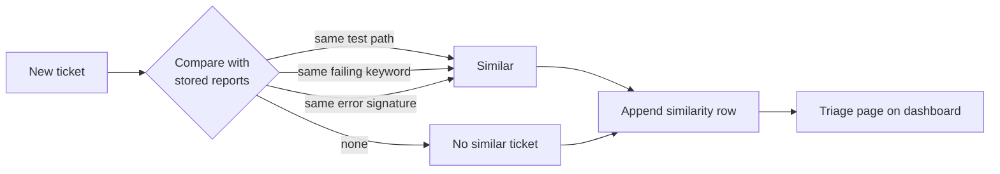

This reduces duplicate investigations and helps correlate a test failure with an existing product defect.

---

## 11. Dashboard Experience

The dashboard is a **static, searchable website**. All heavy lifting happens at build time, so pages load instantly and need no backend.

### 11.1 Layout

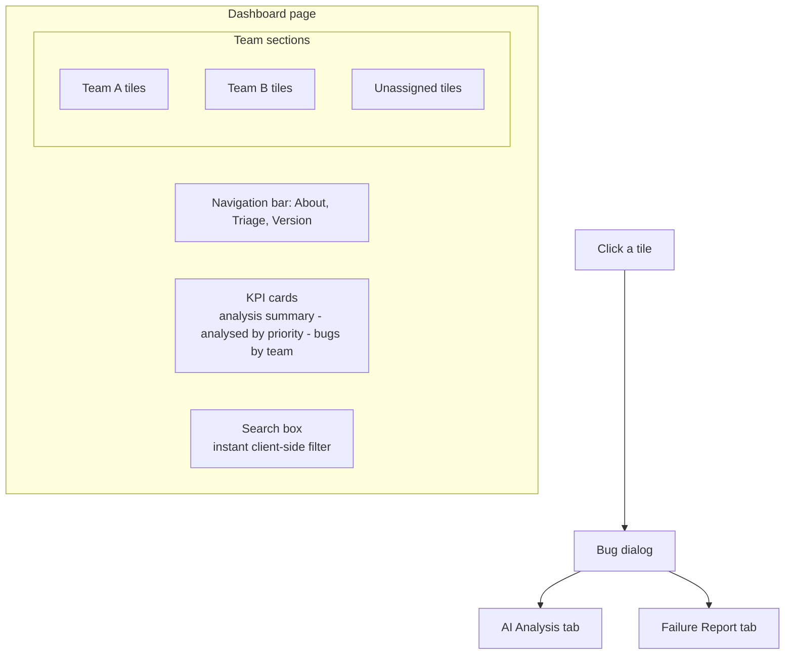

### 11.2 Features

| Feature | Description |

| --- | --- |

| **KPI cards** | Total versus analysed tickets, analysed tickets by priority (critical / major / minor), and tickets by team. |

| **Team-grouped board** | Tiles are grouped by owning team, with an "Unassigned" group last. Tickets are sorted newest first. |

| **Tiles** | Ticket key, priority chip, team chip, analysed / not analysed status, and summary. |

| **Instant search** | Client-side filtering over key, summary, excerpt, status, priority and team. |

| **Bug dialog** | Two tabs, with **AI analysis shown first** and the original failure report second. Report fields are shown as cards for easy scanning. |

| **Triage page** | The similarity table of related tickets. |

| **Deep links** | Ticket keys link back to the issue tracker. |

| **Accessibility** | Keyboard-navigable dialogs, ARIA tabs, and respect for reduced-motion preferences. |

| **Responsive** | One, two or three columns, depending on screen width. |

| **Safe rendering** | HTML is escaped, and only safe link schemes are kept, so ticket or analysis content cannot inject scripts. |

| **Graceful degradation** | If a CDN asset is unreachable, search still works and a warning is shown. |

---

## 12. Reliability, Idempotency and Failure Handling

The pipeline is designed for **unattended operation**, so it is conservative about state.

| Concern | Approach |

| --- | --- |

| **Re-runs** | Reports are write-once and analyses are never re-sent, so running twice is always safe. |

| **Skip logic** | The tracker index is the only work list: an empty analysis field means "do this work". |

| **Verified success** | An analysis counts only if the agent exited cleanly **and** produced a new, non-empty file. |

| **Retry** | Failed analyses stay pending and are retried on the next run. One ticket's failure never stops the others. |

| **Tracker outage** | Bounded retries with back-off. On total failure the live dashboard is left untouched. |

| **Atomic publish** | Build into staging, then swap with renames. Readers never see a partial site. |

| **Cleanup** | Temporary working folders are always removed. |

| **Exit codes** | The run exits with 0 only if every stage succeeded and no analysis failed, so schedulers and alerting can react. |

| **Quiet days** | When nothing is pending, no agent starts and no AI credentials are needed. |

| **Rebuild only** | The site can be rebuilt from existing data without the tracker or the agent. |

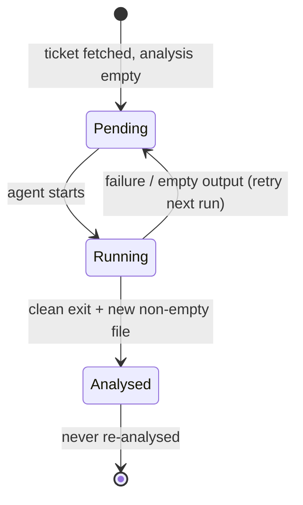

---

## 13. Security and Operational Considerations

Because the agent can read a code repository and download logs, the deployment must be treated carefully.

- **Internal network only.** Published pages may reference internal systems, so they should be served only on a trusted network.

- **Least privilege.** Run the job under a dedicated account with only the access it needs.

- **Secret handling.** Credentials are supplied through environment configuration that is excluded from version control.

- **Bounded behaviour.** Fetch counts are capped, and the agent is instructed to stay within a narrow scope.

- **Human in the loop.** The output is a *first-level* analysis. Engineers confirm before acting, especially when confidence is not High.

- **Safe web output.** Escaped HTML and restricted link schemes protect dashboard readers.

---

## 14. Technology Overview

| Layer | Technology |

| --- | --- |

| Scheduling | Cron (or any scheduler) |

| Orchestration | Python 3 |

| Issue tracking | Jira (REST API, query-language driven) |

| Test framework analysed | Robot Framework (structured XML results and runner logs) |

| AI agent | A headless, command-line AI coding agent run in non-interactive mode |

| Knowledge retrieval | Generated Markdown + fast text search |

| Static site generation | Markdown-to-HTML conversion and Jinja2 templating |

| Front end | HTML, CSS and vanilla JavaScript, with Bootstrap |

| Version control for tests | A distributed VCS checkout, refreshed before each run |

| Storage | Plain files: JSON index, Markdown reports, Markdown analyses |

---

## 15. Limitations and Non-Goals

- **Does not run the tests.** It analyses failures that have already occurred.

- **Does not write back to the issue tracker.** The dashboard is a read-side companion.

- **Reports are snapshots.** After the first fetch, later comments are not pulled into an already-saved report.

- **One analysis per ticket.** A finished analysis is not automatically refreshed.

- **Sequential processing.** One agent runs at a time. This is simple and predictable, but not tuned for very large backlogs.

- **LLM variability.** AI output can be wrong, which is why the system requires evidence, labels uncertainty and allows "inconclusive".

- **Scope of the knowledge base.** The agent is only as well-informed as the knowledge base. Areas outside its target are analysed from code and logs alone.

- **Failures the agent can't see.** If logs are missing, expired or unreachable, the verdict is inconclusive.

---

## 16. Takeaways

1. **Give the agent the same things a senior engineer would use:** the ticket history, the execution logs, the source code, and the domain knowledge.

2. **Make the procedure a document, not code.** A human-readable rules file lets domain experts tune behaviour without redeploying.

3. **Demand evidence.** Tagging every claim as observed, inferred or unknown makes AI output auditable and trustworthy.

4. **Search, don't read.** Large logs and knowledge bases become tractable when treated as search targets.

5. **Prefer simple, explainable retrieval.** Structured Markdown and text search beat heavier infrastructure for exact identifiers.

6. **Design for unattended operation.** Idempotency, verified success, atomic publishing and honest exit codes matter more than cleverness.

7. **Route, don't just diagnose.** Classifying test, product or environment is where the biggest time savings come from.

---

*This document is a conceptual overview only. Due to NDA constraints, no source code, internal identifiers, prompts, or environment-specific details are provided.*
